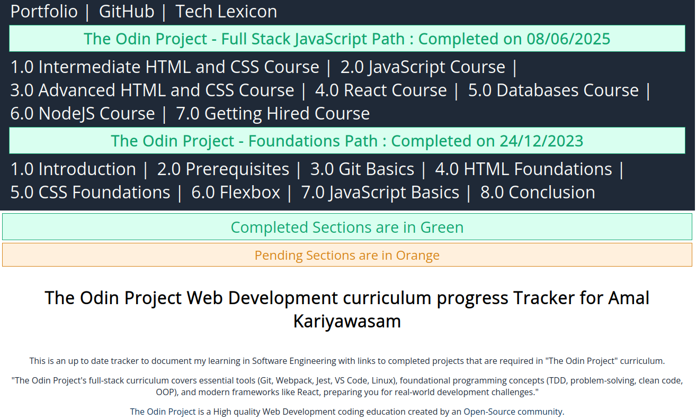
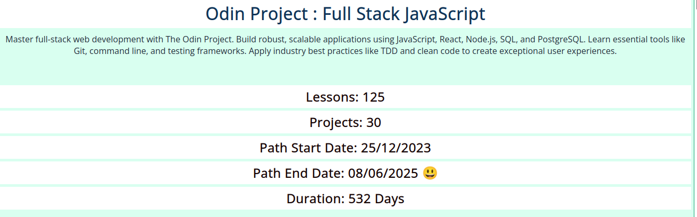
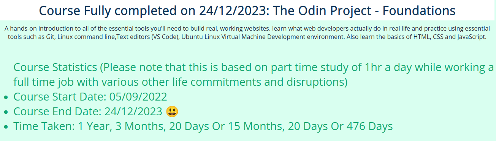

# The Odin Project Progress Tracker

A personal tracker documenting my learning journey through [The Odin Project](https://www.theodinproject.com/), covering the Foundations and Full Stack JavaScript curriculum.

I created this project to track my progress, document completed lessons and exercises, and showcase the projects I've built throughout the curriculum.

It includes links to my completed assignments, project source code and live demonstrations, providing a central place to explore my learning journey and practical work.

## [**Explore The Odin Project Progress Tracker**](https://amalk.au/the-odin-project-tracker/)

## About The Odin Project

[The Odin Project](https://www.theodinproject.com/) is a free, open-source curriculum designed to teach full-stack web development. It provides a structured learning path covering programming fundamentals, frontend development, backend development, databases and professional development.

The curriculum emphasises hands-on learning through coding exercises, assignments and practical projects, helping learners develop the skills needed to become web developers.

## Overview

- **Foundations:** Completed on 24 December 2023.

- **Full Stack JavaScript:** Completed on 8 June 2025.

- **Lessons:** 125 lessons documented.

- **Projects:** 30 projects documented.

Visit the live tracker for the complete curriculum breakdown, progress details, exercises and project links.

## Technologies & Concepts Covered

- **Frontend:** HTML5, CSS3, JavaScript, React, responsive web design, CSS Grid and Flexbox.

- **Backend:** Node.js, Express.js, REST APIs and server-side development.

- **Databases:** SQL, PostgreSQL and relational database design.

- **ORM:** Prisma.

- **Version Control:** Git and GitHub.

- **Build Tools:** Webpack and npm.

- **Testing:** Jest, React Testing Library and Test-Driven Development (TDD).

- **Programming Concepts:** Object-oriented programming, functional programming, asynchronous JavaScript, data structures and algorithms.

- **Development Practices:** DOM manipulation, API integration, debugging, accessibility and application deployment.

## Screenshots

### The Odin Project Full Stack Javascript Course

### The Odin Project Foundations course

## Acknowledgements

- [The Odin Project](https://www.theodinproject.com/) – For providing an excellent free and open-source web development curriculum.

## Contact

- **Portfolio:** [amalk.au](https://amalk.au/)

- **GitHub:** [amalk-au](https://github.com/amalk-au)

---

Developed by **Amal Kariyawasam**.
